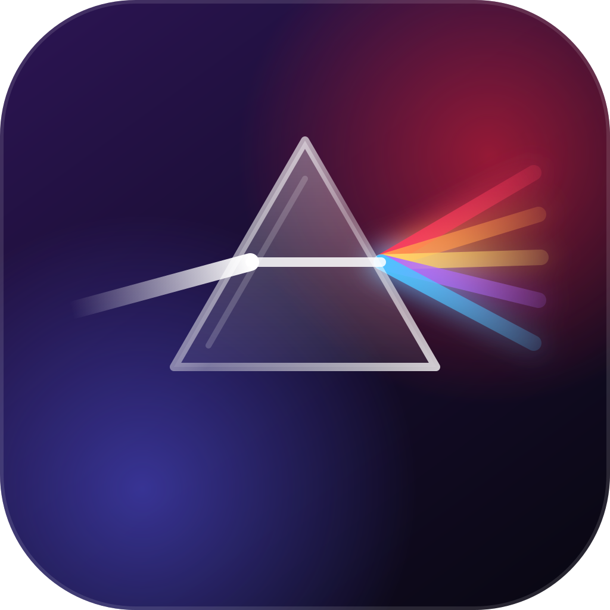
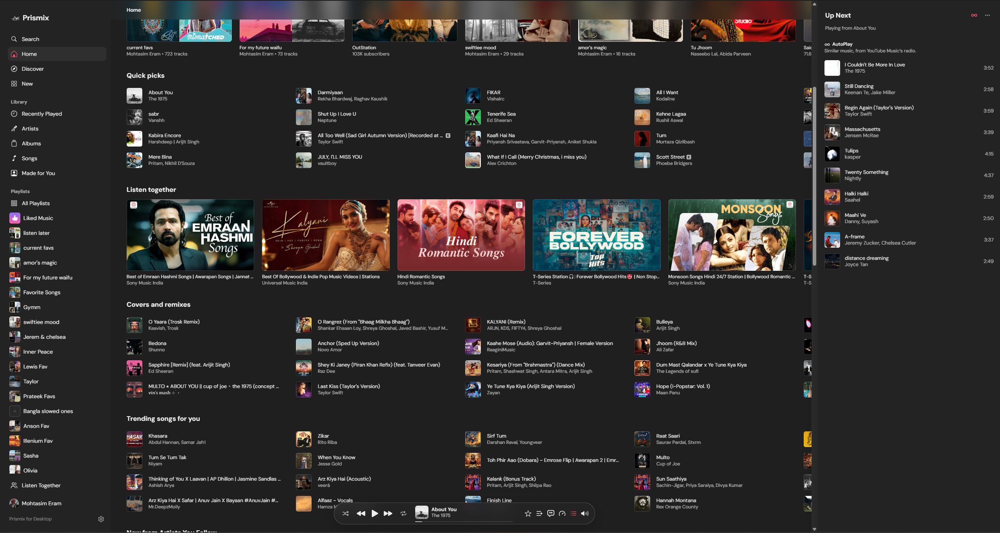
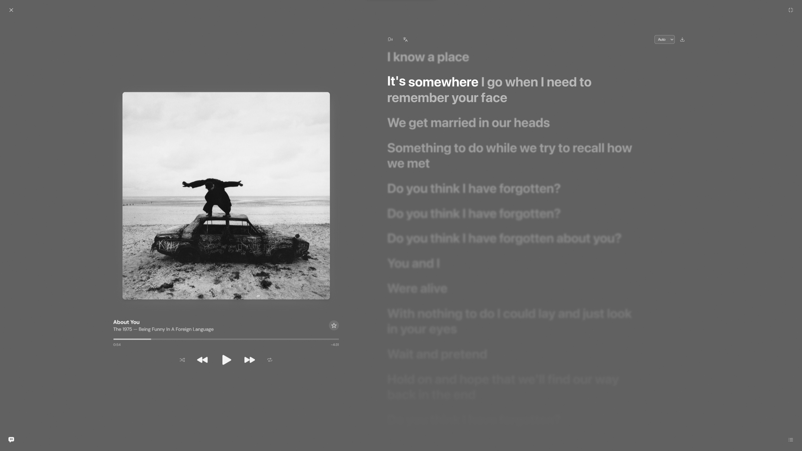
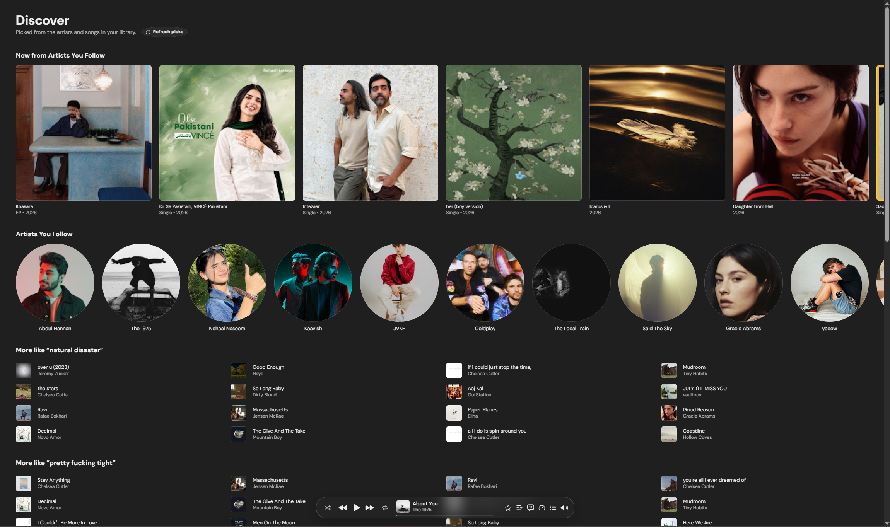
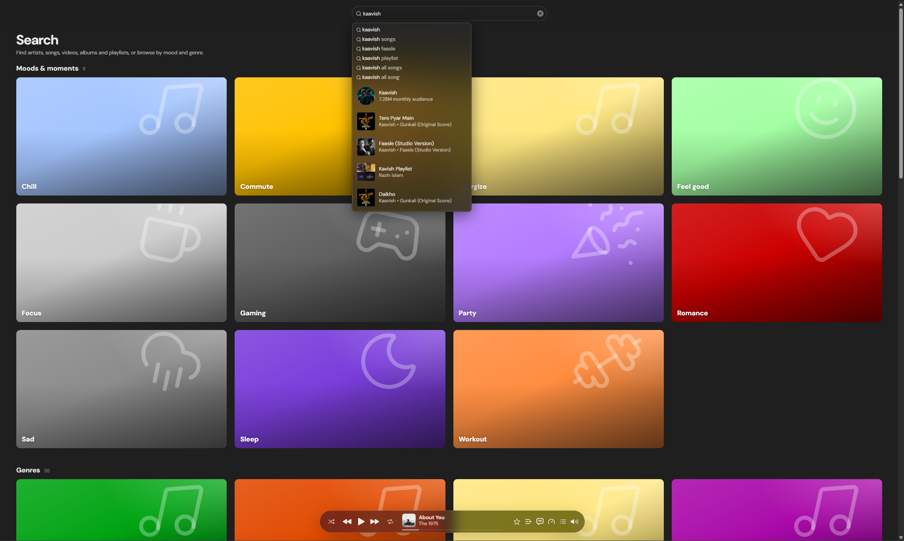

<div align="center">



# Prismix

**A beautiful, Apple Music–style desktop player for YouTube Music.**<br/>
Synced lyrics · Tempo & pitch · Equalizer · Listen Together · Discord presence

<br/>


</div>

---

## ✨ Overview

Prismix wraps YouTube Music in the clean, glassy interface of Apple Music: frosted sidebar, a floating player
pill, a full-screen player with a living colour mesh, and lyrics that glow word by word. It's a small native
app (Tauri + Rust), not a browser tab, so it has a tray icon, media keys, native downloads and Discord presence.

> **Inspired by BitChord.** The look and feel of this desktop app take their inspiration from the
> [BitChord](https://github.com/kushagrasinghx/BitChord) mobile app. **Listen Together works seamlessly between
> Prismix and BitChord**, so friends on the phone app and friends on the desktop can listen in the same room.

## 📸 Screenshots

<!--
  HOW TO ADD SCREENSHOTS:
  1. Save your screenshots in docs/screenshots/ with these names (or change the names below).
  2. Remove the first line of this comment (the one that opens it) and the last line
     (the one that closes it, just under the table) so the table shows up.

<div align="center">
<table>
  <tr>
    <td></td>
    <td></td>
  </tr>
  <tr>
    <td align="center"><sub>Home</sub></td>
    <td align="center"><sub>Now Playing &amp; synced lyrics</sub></td>
  </tr>
  <tr>
    <td></td>
    <td></td>
  </tr>
  <tr>
    <td align="center"><sub>Discover</sub></td>
    <td align="center"><sub>Search</sub></td>
  </tr>
</table>
</div>
-->

## 🎧 Features

**Listening**
- Apple Music–style interface with a floating player pill and full-screen *Now Playing* view
- Word-by-word **synced lyrics** from several providers, with proper rendering for Bangla and other Indic scripts
- **Picks up where you left off**: your queue, the song and the exact second you stopped, plus volume, tempo and pitch
- **Tempo & pitch** control: change speed without changing the key, or the key without changing the speed
- **10-band equalizer** with presets and a preamp
- **Streaming and download quality** settings
- **Save songs** to your computer straight from the track menu
- Optional **music-video playback**: videos play as audio by default, and one button switches to watching

**Library & search**
- **Follow artists** from their pages; their latest releases appear on Home (with a "new since your last visit" count) and in Discover
- **Discover** tab with new artists and songs picked from your own library, plus what's new on YouTube Music
- **Live stations**: 24/7 YouTube Music stations play right from Home
- Sign in to see your YouTube Music library, playlists and favourites
- Search with tabs for **Songs, Videos, Albums, Artists, Playlists**
- **Pin playlists** to the top of the sidebar, each with its cover art
- **Drag and drop** a song from anywhere (track lists, Home shelves, the player bar) onto a playlist
- **Add to Playlist** button right on the player bar
- Redesigned artist pages with a parallax hero

**Desktop touches**
- Resizable sidebar and side panel, remembered between launches
- Tray icon with now-playing, global media keys, and a setting to **minimize to the tray or quit** when you close the window
- **Discord Rich Presence** and **ListenBrainz scrobbling**
- **Listen Together**: listen in sync with friends, on Prismix or on the BitChord mobile app, in the same room
- Back button and `Alt+←` navigation

## 🚀 Get started

**Just want to use it?** Grab the installer from the Releases page and run it.

**Want to build it yourself?**

```bash
git clone <your-repo-url>
cd prismix-desktop
npm install
npm run tauri dev                      # run in development
npm run tauri build -- --bundles nsis  # build the Windows installer + .exe
```

You'll need Node.js 22+, Rust, and (on Windows) the Visual Studio C++ Build Tools.
Full, step-by-step instructions are in **[INSTRUCTIONS.md](./INSTRUCTIONS.md)**.

## 🧱 Built with

| Layer | Tech |
|---|---|
| Interface | React 19, TypeScript, Vite, Tailwind CSS, Framer Motion, Zustand, TanStack Query |
| Audio | Shaka Player, Web Audio API, SoundTouch (pitch shifting), YouTube.js |
| Lyrics | `am-lyrics` renderer with multi-provider fetching |
| Native shell | Tauri v2, Rust (encrypted cookie vault, guarded network proxy, tray, media keys, Discord IPC) |

## 🔐 Privacy & security

- Sign-in cookies are encrypted (AES-256-GCM) with a key in your OS credential store and **never reach the web layer**
- Only the bundled app window can call native commands; sign-in windows can call nothing
- Native networking refuses private, loopback and link-local addresses, including through redirects

## ⚠️ Disclaimer & credits

Prismix is an **unofficial** client. It is not affiliated with or endorsed by YouTube, Google, Apple, Spotify,
Discord, Musixmatch or any other service it connects to. It uses their unofficial or undocumented endpoints,
which can change or stop working at any time, and using them may be against their terms of service. Use it at
your own risk and respect the rights of artists and rights holders.

- Lyrics come from third-party and community-run services (for example LRCLIB and others), which are not
  operated by this project.
- **Listen Together** uses a server run by the original BitChord author unless you point it at your own.
- Prismix draws its inspiration from the **BitChord** app by [kushagrasinghx](https://github.com/kushagrasinghx/BitChord),
  and shares its Listen Together protocol so the two apps can join the same rooms.
  Please check that project's licence and keep its credit.

<div align="center">
<br/>
<sub>Made with 💜 and a lot of light refraction.</sub>
</div>
